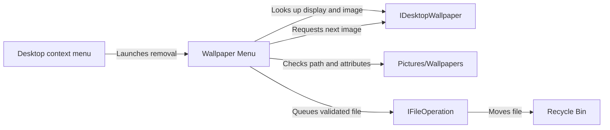

# Architecture

## Overview

The context menu starts a C# executable which uses Windows desktop and Shell interfaces to find, recycle and replace the current wallpaper.



## Components

### Installer

`InstallMenu` places the same executable in the account's local application data folder. It writes the desktop verb under `HKCU\Software\Classes\DesktopBackground\Shell` and tells Windows the associations changed.

### Display and wallpaper resolution

The app captures the physical pointer position at launch. `MonitorAt` compares that position with the rectangles Windows reports for attached displays. `IDesktopWallpaper` supplies the active image path for the matching display.

### Removal and refresh

`ValidateWallpaper` checks the resolved path, filename extension, existence and file attributes. The Windows Shell queues the file for recycling. After a successful operation, `RefreshMonitor` asks Windows to advance the selected display. If Windows rejects that request, the app advances the scheduled display in bounded attempts, checking the selected display after each success.

## Directory layout

```text
WallpaperMenu.cs       Installer, menu handler, and Windows interop
tests/                 Console tests and PowerShell build runner
.github/workflows/     Windows tests, installer releases, and documentation
docs/                  MkDocs source pages
mkdocs.yml             Site identity and navigation
```
